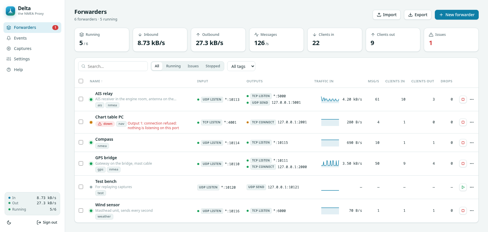
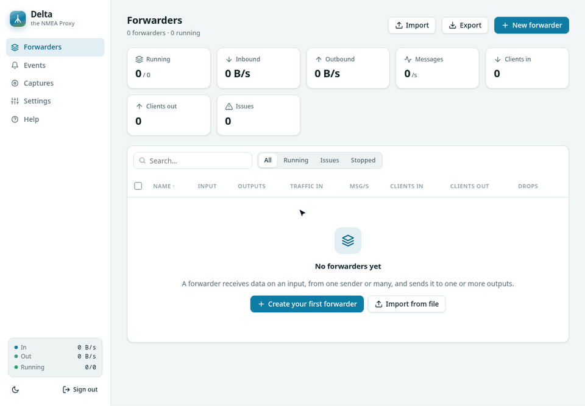

# Delta – the NMEA Proxy

The name comes from a river delta, where one river splits into many channels.

Delta forwards TCP and UDP data streams, such as NMEA telegrams or raw bit streams, and adds very little latency.
One input can receive from many senders at once: several clients on a listen port, several devices Delta connects to,
or UDP datagrams from any number of hosts. Delta merges their messages and sends a copy to every output.
You manage it through a web interface with a password.
Delta is a single static binary. The web interface, the help pages and the libraries it uses are built in, so it runs on servers without internet access.
Delta runs on Linux only (amd64, arm64, armv7 and 386, e.g. a Raspberry Pi). Windows and macOS are not supported.



## Build & run

```bash
scripts/build.sh                    # format check, vet, tests, static binary ./delta
scripts/build.sh --all              # also amd64/arm64/armv7/386 binaries and SHA256SUMS in dist/
VERSION=1.8.0 scripts/build.sh      # embed a version number (--skip-tests to skip the tests)
./delta                             # uses ./delta.json, creates it on first start
./delta -config /etc/delta/delta.json -port 8080
```

| Flag | Meaning |
|---|---|
| `-config <file>` | Config file (default `delta.json`). Created on first start if missing. |
| `-port <n>` | Web interface port. Overrides the config file. |
| `-bind <addr>` | Web interface bind address. Overrides the config file. |
| `-version` | Print the version. |

Open `http://<server>:8470`. On the first start there is no password yet, so the web interface asks you to choose one,
and refuses every other page and API call until you have.
Do this right after starting Delta, because whoever opens the page first can set the password.

The config file never contains the password itself, only a salted PBKDF2-SHA256 hash (`password_hash`).
If you forget the password, stop Delta, add `"password": "new-password"` (at least 8 characters) to the config file and start Delta again.
Delta replaces the line with the hash on startup. Config files from older versions that still contain a plain `password` are converted the same way.

## Your first forwarder

In this example a GPS gateway sends NMEA as UDP to port `10110`. Several navigation apps should connect to Delta over TCP on port `10111`, and all of them should get the same data.



1. On the Forwarders page click **New forwarder** (shortcut `N`).
2. Enter a **name**. Tags and a comment are optional.
3. Keep the data format **NMEA / text lines**. Choose **Raw byte stream** only for binary data.
4. For the input, choose the mode **UDP listen** and port `10110`. Leave the bind address at **All interfaces**.
5. For the output, choose the mode **TCP listen** and port `10111`. With **Add output** you can send the same data to more places.
6. Click **Create & start**. Delta opens the detail page of the new forwarder.
7. Check that data arrives. The **Inbound** tile shows the data rate, and the **Inspector** tab shows the sentences.
8. In your navigation app, connect over TCP to `<Delta machine IP>:10111`. The app then shows up on the **Connections** tab.

If the forwarder can't start, for example because the port is already in use, Delta still saves it. The detail page shows the reason, and Delta tries again every 15 s. Change the port with **Edit**, or stop the program that uses it.
If it works on the Delta machine but not from other machines, a firewall is probably blocking the port (see [Troubleshooting](#troubleshooting)).

To try it without a GPS, `tests/send-nmea.sh -P 10110` sends changing GPS sentences once per second (see `tests/README.md`).

## Run as a systemd service

Download the binary for your platform from the [releases page](https://github.com/TheBigBottle/Delta/releases)
(`delta-linux-amd64`, `-arm64`, `-armv7` or `-386`; check it against `SHA256SUMS`) or build it with `scripts/build.sh`.

### 1. Install the binary and create a service user

```bash
sudo install -m 0755 delta-linux-amd64 /usr/local/bin/delta
sudo useradd --system --no-create-home --shell /usr/sbin/nologin delta
```

### 2. Create the unit file `/etc/systemd/system/delta.service`

```ini
[Unit]
Description=Delta – the NMEA Proxy
Wants=network-online.target
After=network-online.target

[Service]
User=delta
Group=delta
# Creates /var/lib/delta (owned by the delta user) for the config file and captures.
StateDirectory=delta
StateDirectoryMode=0750
ExecStart=/usr/local/bin/delta -config /var/lib/delta/delta.json
Restart=on-failure
RestartSec=2
# Delta shuts down cleanly on SIGTERM; give running forwarders time to stop.
TimeoutStopSec=15

# Hardening
NoNewPrivileges=true
ProtectSystem=strict
ProtectHome=true
PrivateTmp=true
PrivateDevices=true
ProtectKernelTunables=true
ProtectKernelModules=true
ProtectControlGroups=true
RestrictAddressFamilies=AF_INET AF_INET6 AF_UNIX AF_NETLINK
# Uncomment if a forwarder or the web UI must listen on a port below 1024:
#AmbientCapabilities=CAP_NET_BIND_SERVICE

[Install]
WantedBy=multi-user.target
```

The service must be able to write to the config directory, because Delta saves the config by writing a temporary file in the same folder and renaming it.
`data_dir` (captures) and `event_log` are relative to the config file, so they end up in `/var/lib/delta/delta-data`
and `/var/lib/delta/delta-events.log`. To write the event log to `/var/log/delta/` instead, add `LogsDirectory=delta`
to the `[Service]` section and set `"event_log": "/var/log/delta/events.log"`.

### 3. Start it and set the password

```bash
sudo systemctl daemon-reload
sudo systemctl enable --now delta
systemctl status delta
journalctl -u delta -f            # live log
```

Open `http://<server>:8470` right away and choose the password. If other machines need to reach Delta, open the web port and the forwarder ports in the firewall (see Troubleshooting).

Forwarders that were running start again after a reboot (`autostart`). To reset a forgotten password, stop the service,
add `"password"` to `/var/lib/delta/delta.json` and start it again.
To update, replace `/usr/local/bin/delta` and run `sudo systemctl restart delta`.

### Updates from the web interface

Delta can update itself (Settings → Updates, off by default). It downloads the release binary for the machine, checks it against
`SHA256SUMS`, runs it with `-version`, keeps the old binary as `<binary>.old` and restarts with the same command line.
The process ID stays the same, so systemd does not notice the restart.
A binary built without `VERSION` reports the version `dev` and is never replaced by a release, so a self-built Delta is not overwritten.

This needs write access to the folder of the binary, which the setup above does not give (root-owned `/usr/local/bin`, `ProtectSystem=strict`).
To let Delta update itself, put the binary in a folder owned by the service user and allow writing to it:

```bash
sudo install -d -o delta -g delta /opt/delta
sudo install -o delta -g delta -m 0755 delta-linux-amd64 /opt/delta/delta
```

```ini
ExecStart=/opt/delta/delta -config /var/lib/delta/delta.json
ReadWritePaths=/opt/delta
```

The trade-off: the service user can then change its own binary. Keep the root-owned setup if you prefer to update by hand.

## Config file

One JSON file holds the settings and all forwarders. Delta rewrites it whenever you change something in the web interface, using a temporary file and a rename so it is never half written.
You can also edit it by hand while Delta is stopped. Delta refuses to start if the file contains an unknown key, which catches typos.
A forwarder without an `id` gets one automatically.

```json
{
  "port": 8470,
  "bind": "",
  "password_hash": "pbkdf2-sha256$600000$…",
  "data_dir": "delta-data",
  "session_hours": 24,
  "event_log": "delta-events.log",
  "event_log_max_mb": 10,
  "alerts": { "webhook_url": "", "down_after": 30 },
  "updates": { "check": false, "auto_install": false },
  "forwarders": [
    {
      "name": "GPS bridge",
      "tags": ["nmea"],
      "comment": "Gateway on the bridge, mast cable",
      "framing": "lines",
      "autostart": true,
      "idle_alert": 10,
      "input":   { "mode": "udp-listen", "port": 10110 },
      "outputs": [
        { "mode": "tcp-listen", "port": 10111, "max_clients": 50 },
        { "name": "plotter", "mode": "tcp-connect", "host": "192.168.1.20", "port": 2000 }
      ]
    }
  ]
}
```

- `comment` holds free-text notes (up to 4000 characters). The detail page shows them, and the list shows the first part under the name (hover it to read all of it).
- `autostart` records whether the forwarder was running. Forwarders that were running come back after a restart or reboot.
- `data_dir` is where captures are stored. A relative path is relative to the config file's directory.
- `event_log` is the file Delta appends every event to (starts, stops, connects, errors, alerts), one line per event in a syslog-style format:
  ```
  2026-10-30T20:37:39.059+01:00 myhost delta[1234]: INFO Delta 1.3.0 started
  2026-10-30T20:37:41.112+01:00 myhost delta[1234]: ERROR [f3a9c2e17b04] GPS bridge: connect 10.0.0.5:4001: connection refused
  ```
  The severity is `INFO`, `WARNING` or `ERROR`. An event of a forwarder has the forwarder's ID in brackets and its name before the colon.
  A relative path is relative to the config file's directory, and `off` keeps events in memory only.
  At startup Delta loads the newest 5000 events again, so the event list survives a restart.
- `event_log_max_mb` (default 10): when the event log reaches this size, Delta renames it with a timestamp, e.g. `delta-events-2026-11-02T10-15-00.000.log`, deletes the previous renamed file
  and starts a new one. The log therefore uses at most about twice this size. You can also change both settings under Settings → Event log.
- `updates.check` makes Delta ask GitHub for a new release at startup and once a day; `updates.auto_install` also installs it and restarts.
  Both are off by default. See *Updates* below.
- `framing` is either `lines` or `raw`. With `lines`, Delta splits the stream at `\n` and forwards every NMEA sentence whole, also to UDP targets. With `raw`, it forwards the bytes exactly as they arrive.

### Endpoint modes

| Mode | As input | As output |
|---|---|---|
| `tcp-listen` | Any number of sources connect to Delta (up to `max_clients`) and their data is merged | Clients connect and receive the data (`max_clients`, `queue` per client) |
| `tcp-connect` | Delta connects to a source and reconnects automatically. Data from more sources in `targets` is merged | Delta connects to a target, reconnects, and buffers up to `queue` messages while it is down. Each extra host in `targets` gets its own copy and buffer |
| `udp-listen` | Receives datagrams on a port, from any sender | (input only) |
| `udp-send` | (output only) | Sends datagrams to a host |

`targets` (tcp-connect only) lists more remote hosts besides `host`/`port`, e.g. `"targets": [{"host": "10.0.0.6", "port": 4001}]`. Delta keeps one connection to each. While only some of them are connected, the endpoint state is `partial`.

In listen modes `host` is the bind address. Empty means all interfaces, and the editor offers the machine's IP addresses in a dropdown. In the other modes `host` is the remote host.

## Robustness

- Every output and every connected client has its own bounded queue, so a slow or stuck receiver cannot hold up the input or the other outputs. When a queue is full, Delta drops the oldest message and counts it.
- A peer that stops reading is dropped after a 10 s write timeout. TCP keepalive (15 s) detects dead peers, and Delta notices when the remote side closes a connection even while no data flows.
- Reconnects wait longer after each failure, from 200 ms up to 10 s, with some random jitter. Host names are resolved again on every attempt.
- Port conflicts are reported immediately. If a forwarder fails to start, for example at boot, Delta retries it every 15 s.
- A panic in one worker ends only that connection or worker. The process keeps running.

On loopback, a TCP source sending NMEA sentences through Delta to a TCP client measures p50 ≈ 31 µs and p99 ≈ 55 µs, both TCP hops included (`go test -run Latency -v ./internal/engine`).

## System load

Measured with `tests/load-test.sh` on a machine with 32 cores (Delta 1.6.0, everything on loopback, 10 s per scenario, one browser tab open the whole time). CPU is in % of one core.

| Scenario | Forwarders | Sentences/s | MB/s in / out | Delta CPU | Memory (RSS) |
|---|---|---|---|---|---|
| Idle | 0 | 0 | 0 / 0 | 0 % | 16 MB |
| One forwarder, TCP as fast as possible | 1 | 1.95 million | 135 / 135 | 128 % | 23 MB |
| The same with 4 outputs | 1 | 1.47 million | 101 / 405 | 343 % | 39 MB |
| Many forwarders, no traffic | 500 | 0 | 0 / 0 | 0 % | 245 MB |
| Many forwarders, 10 sentences/s each | 500 | 5,000 | 0.3 / 0.3 | 19 % | 279 MB |
| Many forwarders, as fast as the test can send | 500 | 356,000 | 25 / 25 | 545 % | 380 MB |
| Many forwarders, no traffic | 2000 | 0 | 0 / 0 | 1 % | 955 MB |
| Many forwarders, 10 sentences/s each | 2000 | 20,000 | 1.4 / 1.4 | 47 % | 1194 MB |
| Many forwarders, as fast as the test can send | 2000 | 347,000 | 24 / 24 | 577 % | 1405 MB |

No scenario lost data, and the forwarder list in the web interface answered in 2 to 15 ms throughout.

- Over TCP one read brings many sentences, so a sentence costs about 0.7 µs of CPU. Over UDP every sentence is its own datagram and costs about 16 µs. In the rows "as fast as the test can send" the four bash senders were the limit, not Delta, which used about 6 of the 32 cores.
- Idle forwarders cost almost no CPU, but each one uses about 0.5 MB of memory. About half of that is the output queue, which is reserved in full when the forwarder starts (10,000 messages by default). With a queue of 100 messages per output, 2000 idle forwarders used 442 MB instead of 955 MB.
- Every open browser tab receives the complete forwarder list once per second, about 1 KB per forwarder: 0.5 MB/s with 500 forwarders, 2 MB/s with 2000.

To measure your own machine, run `tests/load-test.sh -n 500` (`-h` lists the options; it needs `socat`). It starts its own temporary Delta and leaves a running instance alone.

## Web interface

The forwarder list can be sorted and filtered. It shows tags, comments, a live throughput sparkline and the number of clients in and out, and it can start, stop, restart, tag, delete or export several forwarders at once.

Each forwarder has a detail page with:
- a live diagram of the input and outputs and their states,
- a throughput chart of the last 10 minutes,
- the inspector, with Text, Hex and NMEA views (the NMEA view checks the checksums),
- the connected clients, each with a disconnect button,
- its events, captures and configuration.

The inspector has limits so a busy stream cannot overload the browser. It receives at most the chosen number of messages per second (10 to 2000), at most 256 KB/s of data, and only the first "Preview" bytes of each message (256 B to 16 KB). Anything over these limits is counted as skipped, and forwarding is never slowed down. Long messages are collapsed until you click them, and filter matches are highlighted.

A capture records traffic with timestamps (`.dcap`). You can download it as `.dcap` or as raw data, and replay it into any running forwarder at the original speed, N times faster, at a fixed interval or as fast as possible, optionally in a loop. You can also upload `.dcap` files or plain NMEA logs. The "Inspect" button opens a capture with the same Text, NMEA and Hex views as the inspector. More pages load as you scroll, and the search runs on the server over the whole file (text, or `/regex/` with an optional `i` to ignore case).

Delta has two kinds of alerts. A down alert fires when a forwarder failed to start, or an endpoint has been disconnected for longer than `down_after`. An idle alert fires when no input data has arrived for longer than `idle_alert`. Alerts go to the event log and to a webhook, which works with Slack, Mattermost, Teams, Discord, ntfy and others.

The Events page is one log of everything, which you can filter by level and search. It is also written to the event log file and survives restarts.

Under Settings you set the webhook and the event log file, switch the update check on, change the password, and export or import forwarders as JSON.

The built-in help (`#/help`, or press `?`) is plain Markdown in `web/help.md`.

## REST API

Everything the web interface does is also available over HTTP. Scripts can log in with basic auth and the password:

```bash
curl -u :PASSWORD http://localhost:8470/api/forwarders
curl -u :PASSWORD -X POST http://localhost:8470/api/forwarders/<id>/stop
curl -u :PASSWORD -X POST 'http://localhost:8470/api/forwarders?start=1' \
     -d '{"name":"ais","framing":"lines","input":{"mode":"tcp-connect","host":"10.0.0.5","port":4001},"outputs":[{"mode":"udp-send","host":"10.0.0.9","port":10110}]}'
```

Main routes:
- `GET|POST /api/forwarders`
- `GET|PUT|DELETE /api/forwarders/{id}`
- `POST /api/forwarders/{id}/{start|stop|restart|kick|capture-start|capture-stop|replay-stop}`
- `GET /api/forwarders/{id}/history`
- `GET /api/forwarders/{id}/inspect` (SSE)
- `POST /api/bulk`
- `GET /api/stream` (SSE)
- `GET /api/events`
- `GET /api/interfaces` (IP addresses of the machine, offered as bind addresses)
- `GET /api/export`, `POST /api/import`
- `GET|PUT /api/settings`
- `GET /api/update`, `POST /api/update/check`, `POST /api/update/install` (installs and restarts)
- `GET|POST /api/captures`
- `GET|DELETE /api/captures/{name}`
- `GET /api/captures/{name}/records?from=&limit=&bytes=&filter=` (paged; `next` in the response continues)
- `POST /api/captures/{name}/replay`

## Troubleshooting

### A listen port works from localhost but not from other machines

Delta listens on all interfaces unless a bind address is set. Check with `ss -ltnp 'sport = :10110'`, which should show `*:10110`.
If it does, a firewall on the Delta machine blocks the port. With firewalld (Fedora, RHEL, openSUSE, many Arch setups) only a few services are open by default:

```bash
sudo firewall-cmd --permanent --add-port=10110/tcp   # use /udp for UDP inputs
sudo firewall-cmd --reload
```

With ufw: `sudo ufw allow 10110/tcp`.

### An output shows "host unreachable" although the target answers ping

A firewall on the target rejects that port. Open it there with the same commands.

## Third-party libraries

They are compiled or embedded into the binary, and nothing is loaded from the internet at runtime.

| Library | Used for | License |
|---|---|---|
| [goldmark](https://github.com/yuin/goldmark) | renders the help page from `web/help.md` | MIT |
| [lumberjack](https://github.com/natefinch/lumberjack) | writes and rotates the event log file | MIT |
| [golang.org/x/time/rate](https://pkg.go.dev/golang.org/x/time/rate) | rate limits for the event log and the live inspector | BSD-3-Clause |
| [uPlot](https://github.com/leeoniya/uPlot) 1.6.32 | the throughput chart (`web/vendor/`) | MIT |

## AI disclaimer

Delta was developed with substantial help from an AI coding assistant (Anthropic's Claude), under human direction and review.
The code is covered by automated tests and was tested by hand, but it may still contain mistakes.
Review it and test it in your own environment before relying on it, especially for navigation data where safety matters.
Delta is provided as is, without warranty of any kind.
