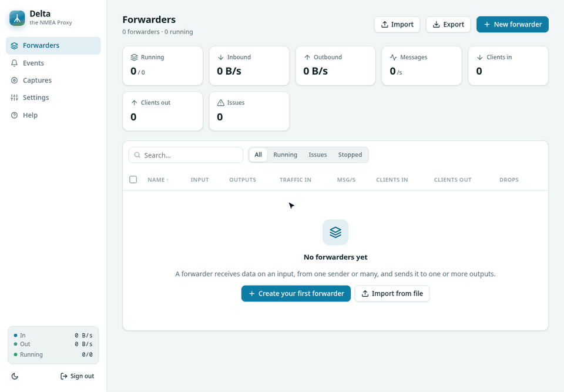

## What Delta does

Delta receives data on an input and sends a copy of every message to one or more outputs. It was built for NMEA (GPS, AIS, compass, wind …), but it works with any TCP or UDP data, binary streams included.

An input together with its outputs is called a forwarder. You can run as many forwarders as you like, and each one runs independently of the others.

- An input can receive from many senders at once and merges their messages into one stream.
- Each message is copied once, and all outputs share that copy.
- Each receiver has its own queue, so a slow receiver never holds up the others.
- On a local machine a message takes about 31 µs from input to output. Using the web interface doesn't slow this down.
- Everything is stored in one config file (`delta.json`). Forwarders that were running start again after a restart or reboot.
- Delta retries broken connections by itself, so you don't have to restart anything after a device reboots.

### Words used in Delta

| Term | Meaning |
|---|---|
| Forwarder | An input and its outputs. |
| Input | Where the data comes from: a port Delta listens on, or devices Delta connects to. |
| Output | Where a copy of the data goes: clients that connect to Delta, devices Delta connects to, or UDP datagrams. |
| Message | With the *lines* format, one NMEA sentence. With *raw*, whatever arrived in one network read. |
| Client / source | A device or program that connected to Delta, or that Delta connected to. |
| Drop | A message thrown away because a receiver was too slow and its queue was full. |
| Capture | A recording of an input with timestamps (a `.dcap` file). |

## Your first forwarder

In this example a GPS gateway sends NMEA as UDP to port `10110`. Several navigation apps should connect to Delta over TCP on port `10111`, and all of them should get the same data.



1. On the [Forwarders](#/) page click **New forwarder** (shortcut `N`).
2. Enter a **name**. Tags and a comment are optional.
3. Keep the data format **NMEA / text lines**. Choose **Raw byte stream** only for binary data (see [Data format](#/help/data-format)).
4. For the input, choose the mode **UDP listen** and port `10110`. Leave the bind address at **All interfaces**.
5. For the output, choose the mode **TCP listen** and port `10111`. With **Add output** you can send the same data to more places.
6. Click **Create & start**. Delta opens the detail page of the new forwarder.
7. Check that data arrives. The **Inbound** tile shows the data rate, and the **Inspector** tab shows the sentences.
8. In your navigation app, connect over TCP to `<Delta machine IP>:10111`. The app then shows up on the **Connections** tab.

If the forwarder can't start, for example because the port is already in use, Delta still saves it. The detail page shows the reason, and Delta tries again every 15 s. Change the port with **Edit**, or stop the program that uses it.

> If it works on this machine but not from other machines, a firewall is probably blocking the port. See [Troubleshooting](#/help/troubleshooting).

## The interface

### Forwarders page

The start page lists all forwarders with their live state.

- **Search** finds names, tags, comments, modes and addresses (shortcut `/`).
- **Issues** shows only the forwarders that failed to start, have a disconnected endpoint or have a firing alert. Click a tag to show only forwarders with that tag.
- Tick the boxes in front of several forwarders to start, stop, restart, tag, export or delete them together.
- The **⋯** button next to a forwarder opens edit, duplicate, export and delete.
- Click a column header to sort by it, and click it again to reverse the order.
- A forwarder's comment appears in small grey text under its name, cut off if it is long. Hover over it to read all of it.

The colored dot shows the health of a forwarder. Green means running, orange means running with an endpoint that is not connected, red means it could not start, and grey means stopped.

### Detail page

Click a forwarder's name to open its detail page. At the top are the Stop/Start, Restart and Edit buttons, a live diagram of the input and outputs, and tiles with the current numbers. If you save changes to a running forwarder, Delta restarts it.

| Tab | Shows |
|---|---|
| Traffic | Data rate of the last 10 minutes. Hover the chart for the values. |
| Inspector | The live data (see [Watch live data](#/help/watch-live-data)). |
| Connections | Every connected client, source and remote host. TCP connections can be disconnected here. |
| Events | This forwarder's log. |
| Captures | Recording of the input (see [Record and replay](#/help/record-and-replay)). |
| Configuration | A summary and the forwarder's JSON. |

### Other pages

- [Events](#/events) is one log of everything (starts, stops, connects, errors, alerts), with the newest 5000 entries.
- [Captures](#/captures) lists all recordings, uploads and running replays.
- [Settings](#/settings) holds the alerts, the event log file, the password, backup, and where the config file is.

### Shortcuts

| Key | What it does |
|---|---|
| `N` | New forwarder (Forwarders page) |
| `/` | Focus the search (Forwarders page) |
| `?` | Open this help |
| `Esc` | Close a dialog or menu |

Hover over a button, column header or badge to see a short explanation. The sun/moon button at the bottom of the sidebar switches between the light and dark theme.

## Common setups

The examples below show the forwarder JSON as it appears in the config file, in exports and in the [REST API](#/help/rest-api). To set them up in the editor, choose the same modes and ports.

### Share one UDP source with many TCP apps

A WiFi gateway broadcasts NMEA as UDP, but apps such as OpenCPN prefer TCP.

```json
{
  "name": "GPS to apps",
  "framing": "lines",
  "input": { "mode": "udp-listen", "host": "", "port": 10110 },
  "outputs": [{ "mode": "tcp-listen", "host": "", "port": 10111, "max_clients": 20 }]
}
```

### Fetch from an NMEA server and push to a plotter

The multiplexer and the plotter are both TCP servers, so Delta connects to both of them. While the plotter is off, Delta keeps the newest messages for it.

```json
{
  "name": "Multiplexer to plotter",
  "framing": "lines",
  "input": { "mode": "tcp-connect", "host": "192.168.1.40", "port": 4001 },
  "outputs": [
    { "mode": "tcp-connect", "host": "192.168.1.20", "port": 2000 },
    { "mode": "tcp-listen", "host": "", "port": 10111 }
  ]
}
```

### Send into another network over UDP

The devices connect to Delta, and Delta sends each sentence as a UDP datagram to a remote host, for example over a VPN.

```json
{
  "name": "Devices to remote",
  "framing": "lines",
  "input": { "mode": "tcp-listen", "host": "", "port": 5000, "max_clients": 5 },
  "outputs": [{ "mode": "udp-send", "host": "10.8.0.1", "port": 10110 }]
}
```

### Several hosts in one endpoint

In **TCP connect** mode, the **Add host** button adds more hosts. For an input, Delta merges what all the hosts send. For an output, each host gets its own copy. If only some of the hosts are connected, the endpoint shows *partial* and the forwarder counts as degraded.

```json
"input": {
  "mode": "tcp-connect", "host": "192.168.1.40", "port": 4001,
  "targets": [{ "host": "192.168.1.41", "port": 4001 }]
}
```

Once one forwarder works, you can use **⋯ → Duplicate** to create similar ones and change only the ports.

## Watch live data

The **Inspector** tab shows the messages the input receives as they arrive.

- **Text**, **NMEA** and **Hex** switch the view. The NMEA view colors the parts of each sentence and checks its checksum (✓ correct, ✗ wrong).
- Type into **Filter** to show only matching messages. Write `/…/` for a regular expression, e.g. `/^\$GP(RMC|GGA)/`, and add `i` after the last slash to ignore case.
- The rate limit sets how many messages per second the browser gets (10 to 2000). On top of that, the server sends at most 256 KB per second. Messages over these limits are counted as *skipped*.
- **Preview** sets how much of each message is transferred (256 B to 16 KB).
- **Pause** freezes the view and **Clear** empties it. The download button saves the last 2000 messages as text.

Watching the Inspector doesn't slow down forwarding. When the browser can't keep up, Delta leaves out inspector data, never forwarded data.

## Record and replay

A capture records everything an input receives, together with the time of each message.

### Record

1. Open the forwarder (it must be running) and go to the **Captures** tab.
2. If you like, enter a duration, a maximum size, or both.
3. Click **Start recording**, and click **Stop** when you are done.

The file is called `<name>-<date>-<time>.dcap` and goes into the `captures` folder of the data directory. Stopping or restarting the forwarder also ends the recording.

### Look at a capture

On the [Captures](#/captures) page, click **Inspect**. The viewer has the same views as the Inspector, and its search runs through the whole file on the server.

### Replay

1. Click **Replay** next to a capture and choose a running forwarder.
2. Choose the timing: **Original** (with a speed factor), **Fixed interval**, or **As fast as possible**.
3. Tick **Loop** if the replay should start over at the end.

The replayed messages go to all outputs of that forwarder, as if its input had received them.

### Download and upload

- A **.dcap** download keeps the timestamps. A **Raw** download contains only the data, for example a plain NMEA log.
- **Upload file** accepts `.dcap` files and text logs with one sentence per line, up to 256 MB. Uploads have no timing, so replay them with a fixed interval.

## Alerts

When something stops working, Delta writes an event and can call a webhook (Slack, Teams, Mattermost, Discord, ntfy, …).

| Alert | Fires when | Set in |
|---|---|---|
| down | a forwarder could not start, or an endpoint was not connected, for longer than *down after* seconds | Settings (all forwarders) |
| idle | a running forwarder received no input for *idle alert* seconds | the editor of each forwarder |

To set them up:

1. Under [Settings](#/settings) → Alerts, enter the webhook URL, e.g. `https://ntfy.sh/<secret-topic>`.
2. Choose the *down after* delay (default 30 s).
3. Click **Send test**, then **Save**.
4. For each forwarder whose silence matters, set **Idle alert (s)** in the editor.

The webhook receives a JSON `POST`, with `status` set to `FIRING` or `RESOLVED`:

```json
{
  "text": "[Delta] FIRING: GPS bridge is idle — no input data for 12s",
  "content": "[Delta] FIRING: GPS bridge is idle — no input data for 12s",
  "forwarder": "GPS bridge",
  "id": "f4918dc90495",
  "alert": "idle",
  "status": "FIRING",
  "detail": "no input data for 12s",
  "time": "2026-10-30T09:27:50Z"
}
```

## Endpoint modes

The mode depends on who opens the connection. If the other side connects to Delta, use a listen mode. If Delta has to reach out, use a connect or send mode. Either way, the data always flows from the input to the outputs.

| Mode | As input | As output |
|---|---|---|
| `tcp-listen` | Devices connect to Delta and send data. | Programs connect to Delta, and each one gets a copy. Each client has its own queue (default 1024 messages), and a stuck client is disconnected after 10 s. |
| `tcp-connect` | Delta connects to a device that serves data (most multiplexers and WiFi gateways do). | Delta connects to a device that accepts data. While the device is down, Delta keeps up to *queue* messages for it (default 10000). |
| `udp-listen` | Delta receives datagrams from any sender. | Not available |
| `udp-send` | Not available | Each message is sent as one datagram. A broadcast address (e.g. 192.168.1.255) reaches the whole network. |

In listen modes the bind address is either *All interfaces* or one IP address of the Delta machine. With `127.0.0.1`, only programs on the same machine can connect.
In connect and send modes the host is the name or IP address of the remote device. Delta looks names up again for every new connection.
Port 10110 is the usual port for NMEA over IP.

## Data format

TCP delivers a stream of bytes without message boundaries, so one read can hold half a sentence or several sentences. The data format decides what Delta does with that.

| Format | Use for | Behaviour |
|---|---|---|
| NMEA / text lines (`lines`) | NMEA 0183, AIS, any line-based text | Splits at `\n`, so receivers and UDP datagrams always get whole sentences. Lines over 8 KB are sent in parts. |
| Raw byte stream (`raw`) | Binary protocols | Passes the bytes on exactly as they arrive, with the lowest delay. |

With `raw` and a UDP output, a sentence can end up split across two datagrams, and most NMEA programs reject that. Use `lines` for NMEA.

## Health and states

| Forwarder | Meaning |
|---|---|
| Running (green) | All endpoints are connected or listening. |
| Degraded (orange) | Running, but an endpoint is not (fully) connected. Delta keeps retrying. |
| Error (red) | Could not start, usually because the port is in use or the bind address does not exist. Delta retries every 15 s. |
| Stopped (grey) | Stopped by you. It stays stopped after Delta restarts. |

| Endpoint state | Meaning |
|---|---|
| listening | The port is open and waiting. |
| connected | The connection to the remote host is up. |
| connecting | Delta is trying to connect. |
| down | Not connected. Delta retries automatically. |
| open | The UDP socket is open, but no datagram has arrived yet. |
| receiving / sending | Datagrams are flowing. |
| unreachable | The remote host reported "port unreachable". |
| partial | Connected to some of several hosts. |

## Queues, drops and reconnects

- Every output, and every client of a TCP listen output, has its own queue. The input never waits for a slow receiver.
- When a queue is full, Delta drops the oldest message and counts it under **Drops**. A few drops after a target was offline are normal. If the number keeps rising, a receiver is too slow.
- You can change the queue sizes in the editor (*Queue*).
- After a failed connection Delta waits 0.2 s before trying again, then doubles the wait up to 10 s, plus up to 20 % random jitter. After a connection that lasted 10 s, the wait starts at 0.2 s again.
- TCP keepalive (15 s) and write timeouts (10 s) detect dead connections.
- An error that repeats is logged only once.

## Settings and files

### Password

- On the first start Delta asks you to choose a password (at least 8 characters). Do it right away, because until then whoever opens the page first can choose it.
- You can change it under [Settings](#/settings). The config file stores only a salted hash.
- If you forget it, stop Delta, add `"password": "new-password"` to the config file and start Delta again. Delta replaces the line with the hash.
- A login lasts 24 hours (`session_hours`).

### Config file

All settings and forwarders are in one JSON file, and Delta saves it after every change. Edit it by hand only while Delta is stopped. Delta refuses unknown keys, which catches typos.

```json
{
  "port": 8470,
  "bind": "",
  "password_hash": "pbkdf2-sha256$600000$…",
  "data_dir": "delta-data",
  "session_hours": 24,
  "event_log": "delta-events.log",
  "event_log_max_mb": 10,
  "alerts": { "webhook_url": "", "down_after": 30 },
  "forwarders": []
}
```

Relative paths (`data_dir`, `event_log`) are relative to the folder of the config file.

### Event log file

Delta appends each event to `event_log` as one syslog-style line, which you can read with `less`, `grep` or `tail -f`:

```
2026-10-30T20:37:41.112+01:00 myhost delta[1234]: ERROR [f3a9c2e17b04] GPS bridge: connection refused
```

When the file reaches `event_log_max_mb`, Delta renames it with a timestamp, deletes the previous renamed file and starts a new one. At startup it loads the newest 5000 events again. With `"event_log": "off"` the events are kept in memory only.

### Command line

| Option | Meaning |
|---|---|
| `-config <file>` | Config file (default `delta.json`), created on first start. |
| `-port <n>` | Port of the web interface (default 8470). |
| `-bind <address>` | Address of the web interface, e.g. `127.0.0.1` for local access only. |
| `-version` | Print the version. |

The web interface uses plain HTTP. If you use it outside a trusted network, put it behind a reverse proxy with HTTPS.

## REST API

Everything the web interface does is also available over HTTP. Scripts log in with HTTP basic auth, using the Delta password and any user name. Request and response bodies are JSON, and errors come back as `{"error": "…"}`.

```bash
# list all forwarders
curl -u :PASSWORD http://DELTA-HOST:8470/api/forwarders

# stop one
curl -u :PASSWORD -X POST http://DELTA-HOST:8470/api/forwarders/<id>/stop

# create a forwarder and start it
curl -u :PASSWORD -X POST 'http://DELTA-HOST:8470/api/forwarders?start=1' \
     -d '{"name":"ais","framing":"lines","input":{"mode":"tcp-connect","host":"10.0.0.5","port":4001},"outputs":[{"mode":"udp-send","host":"10.0.0.9","port":10110}]}'
```

| Route | Purpose |
|---|---|
| `GET`, `POST /api/forwarders` | List, or create (`?start=1` starts it) |
| `GET`, `PUT`, `DELETE /api/forwarders/{id}` | Read, change, delete one forwarder |
| `POST /api/forwarders/{id}/{action}` | `start`, `stop`, `restart`, `kick`, `capture-start`, `capture-stop`, `replay-stop` |
| `GET /api/forwarders/{id}/history` | Throughput of the last 10 minutes |
| `GET /api/forwarders/{id}/inspect` | Live messages (server-sent events) |
| `POST /api/bulk` | One action for several forwarders: `{"ids": […], "action": "start", "value": ""}` |
| `GET /api/stream` | Live state of all forwarders and new events (server-sent events) |
| `GET /api/events` | Event log, newest first (`?forwarder=<id>`, `?limit=`) |
| `GET /api/interfaces` | IP addresses of the Delta machine |
| `GET /api/export`, `POST /api/import` | Backup and import as `{"forwarders": […]}` |
| `GET`, `PUT /api/settings` | Alerts, event log file, password |
| `POST /api/settings/test-webhook` | Send a test message to `{"url": "…"}` |
| `GET`, `POST /api/captures` | List captures, upload a file |
| `GET`, `DELETE /api/captures/{name}` | Download or delete a capture |
| `GET /api/captures/{name}/records` | Read a capture page by page |
| `POST /api/captures/{name}/replay` | Start a replay: `{"forwarder": "<id>", "speed": 1, "interval_ms": 0, "loop": false}` |
| `GET /api/help` | This help, as `{"html": "…"}` |
| `POST /api/login`, `POST /api/logout` | Browser login (not needed with basic auth) |

## Troubleshooting

### Other machines cannot connect to a listen port

This is almost always a firewall on the Delta machine. Open the port:

```bash
# firewalld (Fedora, RHEL, openSUSE, many Arch setups); use /udp for UDP inputs
sudo firewall-cmd --permanent --add-port=10110/tcp
sudo firewall-cmd --reload

# ufw (Ubuntu, Debian)
sudo ufw allow 10110/tcp
```

### "host unreachable" although the device answers ping

A firewall on the target device rejects that port. Open the port on that device.

### "connection refused"

Nothing is listening on that port. Either the port is wrong, the service is off, or the device expects Delta to be the server, in which case you need a listen mode (see [Endpoint modes](#/help/endpoint-modes)).

### "address already in use"

Another forwarder or program already uses the port. `ss -ltnup 'sport = :10110'` shows which one.

### Data arrives, but the receiver shows nothing

- Look at the sentences in the Inspector. Are the checksums correct, and are the sentence types the ones you expect?
- For UDP outputs, use the *lines* format (see [Data format](#/help/data-format)).
- Check the **Connections** tab. Is the receiver connected, and does its byte count grow?

### Where do I see what happened?

The [Events](#/events) page lists every connect, disconnect, error and alert.
